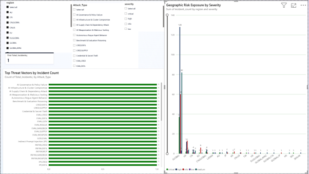

@"
# 🛡️ Enterprise GRC Threat Intelligence Pipeline & Power BI Executive Dashboard

> An end-to-end cybersecurity analytics platform featuring an automated Python threat intelligence ETL pipeline integrated with an interactive Power BI executive dashboard for enterprise risk visualization and data-driven security decision-making.

---

## 📊 Executive Dashboard & Visual Analytics

### 1. Interactive Power BI Executive Dashboard
* **File Location:** [`grc_dash.pbix`](./grc_dash.pbix)
* **Preview:**

---

### 2. Threat Analytics & Machine Learning Visualizations
All pipeline plots and threat classification figures are automatically generated by the Python ETL engine and saved directly to the [`data/`](./data/) directory.

| Visualization | Description | File Path |
| :--- | :--- | :--- |
| **Incident Harm Classification** | Random Forest model feature importance & threat severity prediction | [`data/incident_classification.png`](./data/incident_classification.png) |
| **Attack Vector Heatmap** | Correlation matrix of authentication log anomalies & port scans | [`data/attack_vector_heatmap.png`](./data/attack_vector_heatmap.png) |
| **Temporal Threat Trends** | Time-series analysis of brute-force patterns and unauthorized superuser escalation | [`data/temporal_threat_trends.png`](./data/temporal_threat_trends.png) |

---

## 🏗️ Project Architecture & File Structure