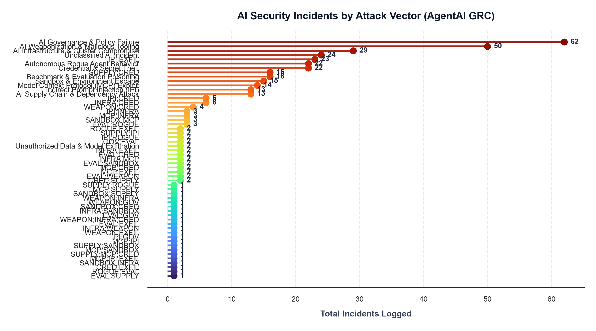
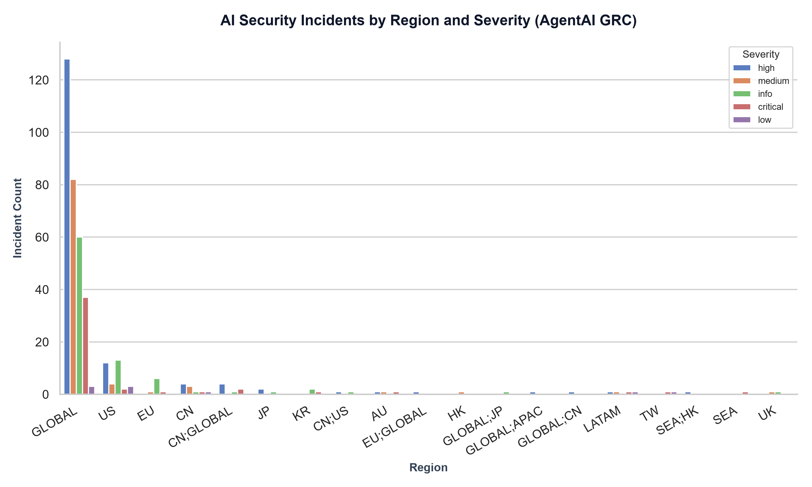

@"
# 🛡️ Enterprise GRC Threat Intelligence Pipeline & Power BI Analytics Platform

> An end-to-end, automated threat intelligence analytics pipeline and executive governance dashboard designed to ingest raw system logs, detect attack patterns, and translate technical security risk into strategic Key Performance Indicators (KPIs) for corporate executives and Risk Committees.

---

## 📊 Executive Overview

In modern enterprise environments, security operations generate massive volumes of disparate log data across host systems, firewalls, and application layers. Bridging the gap between operational security metrics and high-level Governance, Risk, and Compliance (GRC) decision-making requires robust automated processing and clear risk communication.

---

## 📊 Visual Analytics & Threat Intelligence Artifacts

### 1. Interactive Executive Power BI Dashboard
* **File Location:** [`grc_dash.pbix`](./grc_dash.pbix)
* **Target Audience:** Chief Information Security Officers (CISOs), GRC Directors, Enterprise Risk Committees

---

### 2. Threat Analytics Visualizations

#### Attack Types Distribution (Lollipop Chart)
Evaluates frequency and distribution across various threat categories and attack vectors:

#### Regional Risk Exposure by Severity
Cross-correlates regional vulnerability concentration against assessed incident severity levels:

---

## 🏗️ System Architecture & Directory Structure